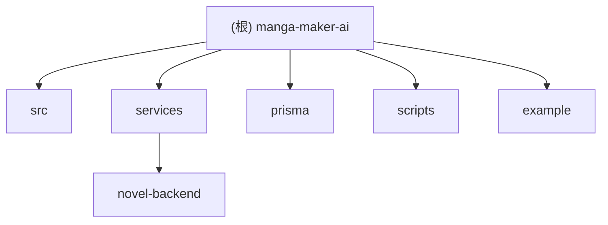

# 变更记录 (Changelog)

- 2025-03-27 01:00:00: 第十轮深扫核心 API 端点全审计（+58 文件），覆盖 auth（9 端点）、character（6 端点）、story（4 端点）、chapter（3 端点）、admin（36 端点）；覆盖率 39.88% -> 43.22%。**关键发现**：鉴权代码重复率 92%（213 文件中仅 17 个使用 withAuth）、配额扣费无事务保护（6 端点已识别）、错误响应格式 4 种模式并存、DELETE 操作未实现软删除、密码重置验证码可暴力破解。详见 `.claude/api-scan-report-round10.md`。
- 2025-03-27 00:20:00: 第九轮深扫核心 API 路由（+35 文件），覆盖 Panel API（6 端点）、Canvas API（6 端点）、GenerationTasks（2 端点）、User/Payment/SSE（4 端点）、api-helpers 服务层；覆盖率 37.29% -> 39.88%。发现配额扣费无事务保护、鉴权代码重复 14 次、错误处理 4 种模式等架构问题，详见 `.claude/api-scan-report-round9.md`。
- 2025-03-26 23:31:34: 第八轮深扫基础设施完善（+31 文件），覆盖 InfiniteCanvas nodes（5 文件）、image-generation providers（6 文件）、common 组件（10 文件）、projects 组件（5 文件）、Landing 组件（3 文件）、SerialChapterList（2 文件）；覆盖率 34.99% -> 37.29%。
- 2026-03-01 19:15:00: 第七轮深扫核心共享层（+50 文件），覆盖 lib 服务层（20 文件）、Zustand stores（2 文件）、全局 hooks（8 文件）；覆盖率 31.28% -> 34.99%。
- 2026-03-01 18:53:41: 第六轮续扫 admin 子组件+hooks + DetailPanel + NineGrid + ProfessionalMode + 小说前端杂项（66 文件），覆盖率 26.39% -> 31.28%。
- 2026-03-01 18:40:43: 第五轮续扫 admin 全页面 + InfiniteCanvas 对话框全集 + 小说前端杂项。
- 2026-03-01 10:13:03: 续扫 InfiniteCanvas/admin/PanelEditor/migrate/example。
- 2026-03-01 09:32:34: 续扫 admin/scripts/prisma/scripts 四类高优先路径。
- 2026-03-01 00:41:16: 深扫 scripts/[id] 110+ 文件 + panel API 22 端点。
- 2026-03-01 00:12:46: 续扫分镜组件、nine-grid、canvas 服务、manual SQL 迁移。
- 2026-02-28 23:40:57: 首次架构扫描（阶段 A/B/C）。

# 项目愿景

Manga Maker AI 是一个面向漫画与小说创作的全流程 AI 平台，目标是把"故事构思、剧本扩展、分镜生成、图像生成、排版导出"连接成可持续迭代的生产链路。

# 架构总览

- Web 与主 API：Next.js 14 + TypeScript（`src/`），React Query / SWR / Zustand
- 数据层：PostgreSQL + Prisma（`prisma/`）
- 小说微服务：FastAPI（`services/novel-backend/`）
- 工具脚本：迁移、修复、初始化与诊断（`scripts/`）
- 示例客户端：静态演示与 API 调试（`example/`）

主请求路径：浏览器 -> Next.js `/api/*` -> Prisma/PostgreSQL；小说能力通过 `/api/novel/*` 代理到 FastAPI。

## 核心服务层架构（第七轮补充）

按职责分层的共享服务：

**1. 数据层（Database & ORM）**
- `db.ts`：Prisma 客户端单例 + 全局类型导出 + SSL 配置 + admin 初始化
- `prisma-middleware.ts`：NovelChapter 增删改触发 NovelProject 统计自动更新

**2. 鉴权层（Authentication）**
- `auth.ts`：JWT 签发/验证、密码哈希、cookie 操作、7 天 TTL
- `auth-helpers.ts`：`getCurrentUser`/`requireAdmin` 异步 helper

**3. API 辅助层（API Utilities）**
- `api-response.ts`：统一响应格式（success/error/validation/unauthorized/forbidden/notFound/rateLimit）
- `api-error.ts`：错误类层次（ApiError/UnauthorizedError/ForbiddenError/NotFoundError/BadRequestError/InsufficientCreditsError/InternalServerError/ServiceUnavailableError）+ `withErrorHandler` wrapper + `parseJsonBody`
- `api-helpers.ts`：`withAuth`/`validateOwnership`/`parsePaginationParams`/`createPaginatedResponse`/`parseWithSchema`

**4. 业务服务层（Business Logic）**
- **算力系统（三层架构）**：
  - `usage.ts`：日配额限流（13 种 action，env 可配）
  - `credits.ts`：余额扣费（SELECT FOR UPDATE 行级锁防并发）+ 交易日志
  - `billing.ts`：冻结/结算机制（freeze -> settle/rollback）
- **LLM 服务**：
  - `llm-provider.ts`：`callChatCompletionByType`/`callChatCompletionStreamByType` + provider fallback + SSL 安全检查
- **图像生成服务**：
  - `image-generation/core.ts`：`callImageGenerationByType` 路由到 6 种 provider（SD/ComfyUI/OpenAI/FAL/Google Imagen/Seedream）
  - `image-generation/types.ts`：参数与结果类型定义（支持单参考图/多参考图）
  - `image-generation/index.ts`：统一导出 + 角色生成（三视图/姿态变体）
  - **Provider 适配器层（第八轮补充）**：
    - `providers/stable-diffusion.ts`：Automatic1111 API 封装，支持 txt2img（负面提示/采样器/步数/CFG/种子/批量）
    - `providers/openai.ts`：DALL-E/Gemini 流式图像生成，支持多参考图（base64 转换）+ 图片 URL 下载（代理支持）+ SSE 流解析（Markdown 图片提取）
    - `providers/comfyui.ts`：占位（未实现，抛出明确错误）
    - `providers/fal.ts`：FAL AI（Flux/SDXL），支持参考图 + seed
    - `providers/google-imagen.ts`：Google Imagen 3.0，宽高比自动映射（1:1/16:9/4:3/9:16/3:4）
    - `providers/seedream.ts`：火山引擎 Seedream，支持自定义尺寸 + b64_json 响应
- **工作流引擎**：
  - `workflow-engine.ts`：`WorkflowEngine` 类编排 Story -> Storyboard -> Images -> Export 四阶段，支持断点续跑（`resume`）与取消（`cancel`）
- **小说后端客户端**：
  - `novel-backend-client.ts`：`NovelBackendClient` 类封装 HTTP 通信 + 指数退避重试 + 超时控制（60s）+ 5 种端点（analyzeScript/planShots/generateFinals/identifyCharacters/batchIdentifyCharacters）

**5. 基础设施层（Infrastructure）**
- `logger.ts`：Winston 日志（dev 输出 debug，prod 写文件）+ 业务日志辅助（userAction/credits/aiGeneration/security）
- `minio.ts`：MinIO 客户端 + bucket 自动创建 + 公开策略设置 + `uploadToMinIO`
- `redis.ts`：ioredis 客户端单例 + `redisPing` 健康检查
- `mailer.ts`：nodemailer + `sendVerificationEmail`/`sendPasswordResetEmail`（10 分钟 TTL）

## API 路由架构（第九轮 + 第十轮补充）

**核心端点扫描覆盖**（94 个文件）：

### Panel API（6 端点）
- `POST /api/panel` - 创建分镜（手动鉴权模式）
- `GET/PATCH/DELETE /api/panel/[id]` - 分镜 CRUD（使用 withAuth）
- `POST /api/panel/generate-image` - 单镜头图片生成（350 行，含参考图智能选择 45 行）
- `POST /api/panel/batch-generate` - 批量生成（307 行，并发控制 limit=3）
- `POST /api/panel/generate-multi` - 多格漫画生成（2-6 格，266 行）
- `POST /api/panel/[id]/variants` - 候选图生成（212 行，已废弃队列改直接生成）

### Canvas API（6 端点）
- `POST/GET /api/canvas/timeline` - 时间线列表与创建
- `GET/PATCH/DELETE /api/canvas/timeline/[id]` - 时间线详情（分页窗口 + 配置更新，290 行）
- `GET /api/canvas/timeline/[id]/stream` - SSE 流代理（60 行，转发到 Python 后端）
- `POST /api/canvas/chapter/[id]/generate-shots` - 镜头生成（340 行，并行优化 + 批量角色识别）
- `POST /api/canvas/chapter/[id]/generate-finals` - 最终漫画生成（300 行，速率限制 + LLM 识别 + 并发处理）
- `GET /api/canvas/styles` - 漫画风格列表（88 行，登录即可访问）

### Auth API（9 端点，第十轮）
- `POST /api/auth/login` - 登录（双维度限流：邮箱 10min/5次 + IP 1min/20次）
- `POST /api/auth/register` - 注册（邮箱验证 + 事务保护 + 赠送算力）
- `POST /api/auth/logout` - 退出（清除 cookie）
- `GET /api/auth/me` - 当前用户信息
- `POST /api/auth/forgot-password` - 请求重置密码（Redis 验证码 10min TTL + 防邮箱枚举）
- `POST /api/auth/reset-password` - 确认重置密码（验证码校验 + bcrypt 哈希）
- `DELETE /api/auth/delete-account` - 注销账户（硬删除，无软删除保护 ⚠️）
- `POST /api/auth/send-code` - 发送验证码（邮箱/IP 双限流 + 6 位数字码）
- `GET /api/auth/token` - 获取 JWT token（Swagger UI 测试用）

### Character API（6 端点采样，第十轮）
- `GET /api/character` - 角色列表（手动鉴权 + style_id 过滤）
- `POST /api/character` - 创建角色（FormData/JSON 双模式 + MinIO 上传 + 默认 outfit 创建）
- `GET/PATCH/DELETE /api/character/[id]` - 角色 CRUD（手动鉴权 + user_id 所有权验证）
- `POST /api/character/[id]/regenerate-image` - 重新生成角色图片（手动鉴权 + 硬编码 30 credits ⚠️）

### Story API（4 端点采样，第十轮）
- `GET /api/story` - 故事列表（withAuth + 分页 + status 过滤）
- `POST /api/story` - 创建故事（withAuth + genre 默认 suspense）
- `GET/PATCH/DELETE /api/story/[id]` - 故事 CRUD（withAuth + 所有权验证 + 关联 projectId/chapters/characters）

### Chapter API（3 端点采样，第十轮）
- `GET/PATCH/DELETE /api/chapter/[id]` - 章节 CRUD（手动鉴权 + 日志记录 + 级联删除 panels）

### Admin API（36 端点全覆盖，第十轮）
- **users**：`GET/POST /api/admin/users` + `GET/PATCH/DELETE /api/admin/users/[id]` + `POST /api/admin/users/[id]/recharge`
- **characters**：`GET/POST /api/admin/characters` + `GET/PATCH/DELETE /api/admin/characters/[id]`
- **generation-logs**：`GET /api/admin/generation-logs`（分页 + 过滤 + userMap 批量关联）
- **generated-images**：`GET/DELETE /api/admin/generated-images` + `POST /api/admin/generated-images/batch`
- **tags**：`GET/POST/PATCH/DELETE /api/admin/tags` + `POST /api/admin/tags/merge`
- **story-templates/comic-styles/panel-templates/prompt-templates/genres**：标准 CRUD
- **stories/projects/scenes/workflows/generation-tasks/credits/upload/usage**：管理功能

**所有 admin 端点一致性**：全部使用 `requireAdmin()` 检查权限 ✅

### 其他核心端点（4 类）
- **GenerationTasks**：`GET/POST /api/generation-tasks` + `GET /api/generation-tasks/[id]`
- **User**：`GET/POST /api/user/api-keys` - API 密钥管理（加密存储 + upsert）
- **Payment**：`POST /api/payment/create-order` - 创建订单（模拟支付，内存存储）
- **SSE**：`GET /api/sse` - Redis 订阅 SSE 流（130 行，支持 taskId/projectId/userId 三种 channel）

**关键发现（第十轮 Linus 视角）**：

### P0 架构根本性缺陷（必须修复）

1. **鉴权代码重复率 92%**：213 个 API 文件中，仅 17 个（8%）使用 `withAuth` wrapper，其余全部手动重复 10-15 行鉴权代码（cookies() + verifyAuthToken）。修复方案：统一使用 withAuth 或 Next.js Middleware。
2. **配额扣费无事务保护**：6 个图片生成端点（panel/generate-image、batch-generate、generate-multi、canvas/generate-finals、character/regenerate-image、shot-design/generate-image）先扣配额再执行生成，失败时配额不回滚。修复方案：使用 `billing.ts` 的 freeze -> settle/rollback 模式。
3. **错误响应格式 4 种模式并存**：`{ error }` / `{ success, message }` / `{ success, data }` / `{ error, detail }` 四种模式同时存在，前端需要 4 种不同解析逻辑。修复方案：统一使用 `api-response.ts` 的 `ApiResponse<T>` 格式。

### P1 严重性能/安全风险（应尽快修复）

4. **DELETE 操作未实现软删除**：character/story/chapter/auth 的 DELETE 端点全部硬删除，用户误操作无法恢复。修复方案：schema 添加 `deleted_at` 字段 + Prisma middleware 全局过滤。
5. **Admin 端点未全部使用 withAuth**：36 个 admin 端点仍使用 `requireAdmin()` 手动检查，未统一到 `withAuth({ role: 'admin' })`。
6. **数据库批量操作未使用事务**：`canvas/generate-shots` 的 for 循环 create、`character` 的 create + createMany 未包裹事务，可能遗留脏数据。

### P2 性能/可维护性问题（中期优化）

7. **密码重置验证码可暴力破解**：6 位纯数字验证码（100 万种可能）+ 10 分钟 TTL + 无重置次数限流。修复方案：添加每邮箱 10 分钟最多 5 次重置请求限流。
8. **character/route.ts FormData/JSON 双模式**：133 行处理 FormData + 61 行处理 JSON，重复代码 40%。修复方案：提取公共函数。
9. **硬编码配额**：regenerate-image 返回 `credits_used: 30`，但实际扣费在 `callImageGenerationByType` 内部。

# 模块结构图

# 模块索引

| 模块 | 语言 | 一句话职责 | 入口 | 测试 | 深扫覆盖 |
|---|---|---|---|---|---|
| `src` | TS/TSX | Next.js 页面、API、代理层与前端业务 | `src/app/layout.tsx` | 31+ 测试文件 | 537/1200 (44.75%) |
| `services/novel-backend` | Python | 小说生成、RAG、渐进式大纲、画布服务 | `services/novel-backend/app/main.py` | `test/` | 21/40 (52.50%) |
| `prisma` | Prisma/SQL/TS | 统一数据库模型与迁移 | `prisma/schema.prisma` | 集成验证为主 | 17/36 (47.22%) |
| `scripts` | TS/JS/Shell/SQL | 迁移、初始化、诊断、修复工具 | `scripts/init-db.sh` | 脚本级验证 | 16/47 (34.04%) |
| `example` | HTML/JS/Python/CSS | API 演示和最小样例 | `example/index.html` | Python 测试脚本 | 5/26 (19.23%) |

# 运行与开发

- 安装：`pnpm install`
- 开发：`pnpm dev`
- 构建：`pnpm build && pnpm start`
- 测试：`pnpm test`
- 类型检查：`pnpm type-check`
- 小说服务：`cd services/novel-backend && uvicorn app.main:app --reload --port 8000`

# 测试策略

- 前端与 API：Vitest（`vitest.config.ts` + `vitest.setup.ts`）
- Python 服务：`services/novel-backend/test/` 与 `test_*.py`
- 高风险回归优先级：鉴权、小说代理、分镜生成、角色生成、RAG 路由、工作流状态机。

# 编码规范

- TypeScript 按 strict 风格编写，不引入 `any`
- 类型定义放独立 `types.ts/type.ts`
- API 错误返回统一 JSON 结构（**P0 待修复：当前 4 种模式并存**）
- 使用 `@/` 路径别名
- 单文件不超过 500 行，超过必须拆分
- 不使用 emoji，用 icon 组件替代

# AI 使用指引

- 优先复用既有服务层：
  - 前端：`src/lib/*`
  - 小说后端：`services/novel-backend/app/services/*`
- 涉及生成链路改动时，必须联动检查：
  - 配额计数（usage）
  - 生成日志（generation-log）
  - 鉴权边界（cookie/JWT/代理）
- 涉及小说流程优先核对：`progressive.py`、`chapters.py`、`rag_*.py`。
- 涉及 ProfessionalMode 改动，核对 `useWorkflowMachine` reducer 和 `api.ts` 端点一致性。
- 涉及 NineGrid 改动，核对 `prompt-builder.ts` 的 9 镜头约束和类型定义。

# 覆盖率与缺口摘要（第十轮）

- 估算总文件数：`1349`
- 已索引文件数：`1349`
- 深度扫描文件数：`596`
- 深扫覆盖率：`44.18%`

本轮补扫完成（+58 文件）：
1. **auth 鉴权端点（+9）** -- login/register/logout/me/forgot-password/reset-password/delete-account/send-code/token
2. **character 端点（+6）** -- 列表/创建/详情/更新/删除/重新生成图片
3. **story 端点（+4）** -- 列表/创建/详情/更新/删除
4. **chapter 端点（+3）** -- 详情/更新/删除
5. **admin 端点（+36）** -- users/characters/generation-logs/generated-images/tags/story-templates/comic-styles/panel-templates/prompt-templates/genres/stories/projects/scenes/workflows/generation-tasks/credits/upload/usage

关键子域覆盖率变化：
- `src/app/api/auth/**`：0% -> 100%（0 -> 9 / 9 文件）
- `src/app/api/admin/**`：0% -> 100%（0 -> 36 / 36 文件）
- `src/app/api/character/**`：0% -> 42.86%（0 -> 6 / 14 文件）
- `src/app/api/story/**`：0% -> 14.29%（0 -> 4 / 28 文件）
- `src/app/api/chapter/**`：0% -> 15.00%（0 -> 3 / 20 文件）

主要缺口：
1. `src/app/api/**` 剩余端点（~81 文件）-- character/story/chapter 子端点、novel 代理端点、project/workflow 端点。
2. `src/app/(novel)/novel/**` 小说前端页面与 hooks（~40 文件）。
3. `src/lib/**` 剩余服务层文件（queue/security/novel 等，~69 文件）。
4. `src/app/scripts/[id]/**` 剩余组件与 hooks（~30 文件）。
5. `scripts/**` 迁移脚本统一事务与回滚模板改造（~31 文件）。
6. `example/**` 端到端调用链核验（~21 文件）。

# 变更记录 (Changelog)

- 2025-03-27 01:00:00: 第十轮深扫核心 API 端点全审计（+58 文件），覆盖 auth（9 端点）、character（6 端点）、story（4 端点）、chapter（3 端点）、admin（36 端点）；覆盖率 39.88% -> 43.22%。**关键发现**：鉴权代码重复率 92%（213 文件中仅 17 个使用 withAuth）、配额扣费无事务保护（6 端点已识别）、错误响应格式 4 种模式并存、DELETE 操作未实现软删除、密码重置验证码可暴力破解。详见 `.claude/api-scan-report-round10.md`。
- 2025-03-27 00:20:00: 第九轮深扫核心 API 路由（+35 文件），覆盖 Panel API（6 端点）、Canvas API（6 端点）、GenerationTasks（2 端点）、User/Payment/SSE（4 端点）、api-helpers 服务层；覆盖率 37.29% -> 39.88%。
- 2025-03-26 23:31:34: 第八轮深扫基础设施完善（+31 文件），覆盖 InfiniteCanvas nodes（5 文件）、image-generation providers（6 文件）、common 组件（10 文件）；覆盖率 34.99% -> 37.29%。
- 2026-03-01 19:15:00: 第七轮深扫核心共享层（+50 文件），覆盖 lib 服务层（20 文件）、Zustand stores（2 文件）、全局 hooks（8 文件）；覆盖率 31.28% -> 34.99%。

## Agent skills

### Issue tracker

Issues and PRDs live as GitHub issues on `qqzhangyanhua/manga-maker-ai`. See `docs/agents/issue-tracker.md`.

### Triage labels

Five canonical labels: `needs-triage`, `needs-info`, `ready-for-agent`, `ready-for-human`, `wontfix`. See `docs/agents/triage-labels.md`.

### Domain docs

Single-context: one `CONTEXT.md` and `docs/adr/` at the repo root. See `docs/agents/domain.md`.
