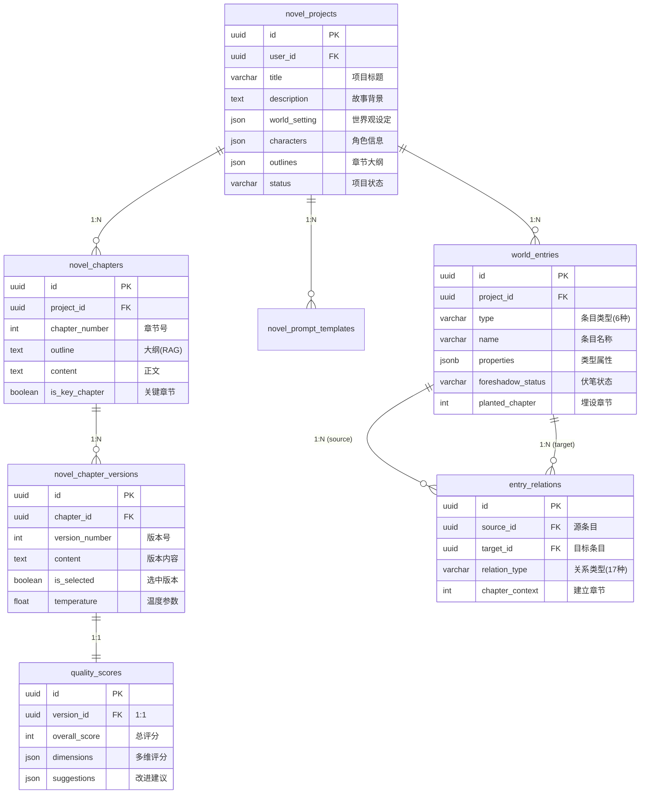

# Novel Backend 数据库结构文档

> **版本**: 1.0
> **日期**: 2026-01-19
> **数据库**: PostgreSQL 14+
> **ORM**: SQLAlchemy (异步)

---

## 📊 目录

- [核心项目表](#核心项目表)
  - [novel_projects](#1-novel_projects---小说项目表)
  - [novel_chapters](#2-novel_chapters---小说章节表)
  - [novel_chapter_versions](#3-novel_chapter_versions---章节版本表)
  - [quality_scores](#4-quality_scores---章节质量评分表)
- [Prompt 管理](#prompt-管理)
  - [novel_prompt_templates](#5-novel_prompt_templates---prompt-模板表)
- [世界观记忆库](#世界观记忆库)
  - [world_entries](#6-world_entries---世界观条目表)
  - [entry_relations](#7-entry_relations---条目关系表)
- [配额与日志](#配额与日志)
  - [novel_quotas](#8-novel_quotas---用户配额表)
  - [maintenance_logs](#9-maintenance_logs---维护日志表)
- [关系图](#数据库关系图-erd)
- [常用查询示例](#常用查询示例)

---

## 核心项目表

### 1. `novel_projects` - 小说项目表

**用途**: 存储小说项目的基本信息、世界观设定和统计数据

```sql
CREATE TABLE novel_projects (
    -- 主键
    id UUID PRIMARY KEY DEFAULT gen_random_uuid(),

    -- 所属用户
    user_id UUID NOT NULL,  -- 关联 User 表（Next.js 端管理）

    -- 基本信息
    title VARCHAR(200) NOT NULL,       -- 项目标题
    description TEXT,                  -- 项目简介/故事背景
    genre VARCHAR(50),                 -- 类型：玄幻/都市/科幻等

    -- 世界观和角色（JSON 存储，灵活扩展）
    world_setting JSON,                -- 世界观设定（力量体系、地理等）
    characters JSON,                   -- 角色列表及详细信息
    outlines JSON,                     -- 章节大纲（结构化数据）

    -- 项目配置
    target_words INTEGER,              -- 目标字数
    status VARCHAR(50) DEFAULT 'draft', -- 状态：draft/writing/completed/published

    -- 统计字段（自动更新）
    total_words INTEGER DEFAULT 0,     -- 总字数（所有章节累计）
    chapter_count INTEGER DEFAULT 0,   -- 章节数量

    -- 时间戳
    created_at TIMESTAMPTZ DEFAULT NOW(),
    updated_at TIMESTAMPTZ DEFAULT NOW()
);

-- 索引
CREATE INDEX idx_novel_projects_user_status ON novel_projects(user_id, status);
CREATE INDEX idx_novel_projects_user_time ON novel_projects(user_id, updated_at);
```

**关联关系**:
- `user_id` → 外部 Next.js 用户表（跨系统关联）
- **1:N** → `novel_chapters`（一个项目有多个章节）
- **1:N** → `novel_prompt_templates`（项目自定义 Prompt）
- **1:N** → `world_entries`（项目的世界观条目）

**字段说明**:
| 字段 | 类型 | 说明 |
|------|------|------|
| `world_setting` | JSON | 存储力量体系、地理设定、时间线等结构化数据 |
| `characters` | JSON | 主要角色信息，包含性格、能力、关系网 |
| `outlines` | JSON | 章节大纲数组，每个元素包含章节号、标题、梗概 |
| `status` | VARCHAR | `draft`(草稿), `writing`(创作中), `completed`(已完结), `published`(已发布) |

---

### 2. `novel_chapters` - 小说章节表

**用途**: 存储章节内容、大纲和生成参数

```sql
CREATE TABLE novel_chapters (
    -- 主键
    id UUID PRIMARY KEY DEFAULT gen_random_uuid(),

    -- 外键
    project_id UUID NOT NULL,  -- 所属项目

    -- 章节标识
    chapter_number INTEGER NOT NULL,   -- 章节序号（1, 2, 3...）
    title VARCHAR(200) NOT NULL,       -- 章节标题

    -- 内容
    outline TEXT,                      -- 章节大纲（用于 RAG 检索）
    content TEXT,                      -- 完整正文内容
    word_count INTEGER DEFAULT 0,      -- 字数统计

    -- AI 生成追踪
    prompt_used TEXT,                  -- 生成时使用的 Prompt
    model_used VARCHAR(100),           -- 使用的模型（如 gpt-4-turbo）

    -- 状态
    status VARCHAR(50) DEFAULT 'draft', -- 状态：draft/reviewing/published
    is_key_chapter BOOLEAN DEFAULT FALSE, -- 是否关键章节（用于 RAG 优先级）

    -- 时间戳
    created_at TIMESTAMPTZ DEFAULT NOW(),
    updated_at TIMESTAMPTZ DEFAULT NOW(),

    -- 外键约束
    CONSTRAINT fk_chapter_project FOREIGN KEY (project_id)
        REFERENCES novel_projects(id) ON DELETE CASCADE
);

-- 索引
CREATE INDEX idx_novel_chapters_project_order ON novel_chapters(project_id, chapter_number);
CREATE INDEX idx_novel_chapters_key ON novel_chapters(project_id, is_key_chapter);
```

**关联关系**:
- **N:1** → `novel_projects`（多章节属于一个项目）
- **1:N** → `novel_chapter_versions`（一个章节可以有多个版本）

**字段说明**:
| 字段 | 类型 | 说明 |
|------|------|------|
| `outline` | TEXT | 大纲用于向量检索（RAG），生成后续章节时作为上下文 |
| `content` | TEXT | 最终选定的正文内容（6000+ 字） |
| `is_key_chapter` | BOOLEAN | 标记重要章节，RAG 检索时优先使用 |
| `prompt_used` | TEXT | 记录生成参数，用于版本对比和 Prompt 优化 |

**业务逻辑**:
- 章节生成时使用 RAG 检索相似章节作为上下文
- 生成后自动创建 `novel_chapter_versions` 记录
- `word_count` 更新时自动同步到 `novel_projects.total_words`

---

### 3. `novel_chapter_versions` - 章节版本表

**用途**: 存储同一章节的多个 AI 生成版本，支持对比和评分

```sql
CREATE TABLE novel_chapter_versions (
    -- 主键
    id UUID PRIMARY KEY DEFAULT gen_random_uuid(),

    -- 外键
    chapter_id UUID NOT NULL,  -- 所属章节

    -- 版本标识
    version_number INTEGER NOT NULL,   -- 版本号（1, 2, 3...）

    -- 内容
    content TEXT NOT NULL,             -- 该版本的正文内容
    word_count INTEGER DEFAULT 0,      -- 字数统计

    -- 生成参数
    prompt_used TEXT,                  -- 生成时使用的 Prompt
    model_used VARCHAR(100),           -- 使用的模型
    temperature FLOAT DEFAULT 0.7,     -- 温度参数（0-2）

    -- 状态
    is_selected BOOLEAN DEFAULT FALSE, -- 是否被选为最终版本
    user_rating INTEGER,               -- 用户评分（1-5）
    notes TEXT,                        -- 用户备注

    -- 时间戳
    created_at TIMESTAMPTZ DEFAULT NOW(),

    -- 外键约束
    CONSTRAINT fk_version_chapter FOREIGN KEY (chapter_id)
        REFERENCES novel_chapters(id) ON DELETE CASCADE
);

-- 索引
CREATE INDEX idx_chapter_versions_selected ON novel_chapter_versions(chapter_id, is_selected);
```

**关联关系**:
- **N:1** → `novel_chapters`（多版本属于一个章节）
- **1:1** → `quality_scores`（每个版本可以有一个质量评分）

**字段说明**:
| 字段 | 类型 | 说明 |
|------|------|------|
| `version_number` | INTEGER | 递增版本号，同一章节内唯一 |
| `is_selected` | BOOLEAN | 只有一个版本可以为 `true`，用于确定最终正文 |
| `temperature` | FLOAT | 记录生成参数，用于分析不同温度的效果 |
| `user_rating` | INTEGER | 用户主观评分，配合 AI 评分综合评估 |

**业务逻辑**:
- 选择新版本时，旧版本的 `is_selected` 自动设为 `false`
- 删除版本时，关联的 `quality_scores` 自动级联删除

---

### 4. `quality_scores` - 章节质量评分表

**用途**: 存储 AI 对章节版本的多维度质量评分

```sql
CREATE TABLE quality_scores (
    -- 主键
    id UUID PRIMARY KEY DEFAULT gen_random_uuid(),

    -- 外键（唯一约束，1:1 关系）
    version_id UUID NOT NULL UNIQUE,  -- 关联版本

    -- 评分
    overall_score INTEGER NOT NULL,   -- 总评分（1-100）
    dimensions JSON NOT NULL,         -- 多维度评分详情
    suggestions JSON,                 -- AI 改进建议

    -- 元数据
    analyzed_at TIMESTAMPTZ DEFAULT NOW(),
    analyzer_version VARCHAR(50) DEFAULT '1.0',

    -- 外键约束
    CONSTRAINT fk_score_version FOREIGN KEY (version_id)
        REFERENCES novel_chapter_versions(id) ON DELETE CASCADE
);
```

**关联关系**:
- **1:1** → `novel_chapter_versions`（每个版本对应一个评分）

**字段说明**:
| 字段 | 类型 | 说明 |
|------|------|------|
| `overall_score` | INTEGER | 综合评分，范围 1-100 |
| `dimensions` | JSON | 包含：爽点密度、节奏分析、对话质量、情节连贯性等多个维度 |
| `suggestions` | JSON | AI 生成的改进建议数组，如：["增加对话细节", "加强情节转折"] |
| `analyzer_version` | VARCHAR | 评分算法版本，用于区分不同迭代的评分标准 |

**JSON 结构示例**:
```json
{
  "dimensions": {
    "pleasure_density": 85,    // 爽点密度
    "pacing": 78,              // 节奏控制
    "dialogue_quality": 90,    // 对话质量
    "plot_coherence": 82,      // 情节连贯性
    "character_consistency": 88 // 角色一致性
  },
  "suggestions": [
    "第三段节奏偏慢，建议增加冲突点",
    "主角对话可以更有性格特点"
  ]
}
```

---

## Prompt 管理

### 5. `novel_prompt_templates` - Prompt 模板表

**用途**: 存储用户自定义和系统预设的 Prompt 模板

```sql
CREATE TABLE novel_prompt_templates (
    -- 主键
    id UUID PRIMARY KEY DEFAULT gen_random_uuid(),

    -- 关联
    project_id UUID,  -- 项目级模板（可为空表示全局）
    user_id UUID,     -- 创建者（可为空表示系统模板）

    -- 基本信息
    name VARCHAR(100) NOT NULL,        -- 模板名称
    category VARCHAR(50) NOT NULL,     -- 类别：chapter_generation/outline/character

    -- 模板内容
    template TEXT NOT NULL,            -- Prompt 文本（支持变量占位符）
    variables JSON,                    -- 变量定义和默认值

    -- 配置
    is_public BOOLEAN DEFAULT FALSE,   -- 是否公开分享
    is_system BOOLEAN DEFAULT FALSE,   -- 是否系统预设

    -- 统计
    usage_count INTEGER DEFAULT 0,     -- 使用次数

    -- 时间戳
    created_at TIMESTAMPTZ DEFAULT NOW(),
    updated_at TIMESTAMPTZ DEFAULT NOW(),

    -- 外键约束
    CONSTRAINT fk_prompt_project FOREIGN KEY (project_id)
        REFERENCES novel_projects(id) ON DELETE CASCADE
);

-- 索引
CREATE INDEX idx_novel_prompts_category ON novel_prompt_templates(category, is_public);
CREATE INDEX idx_novel_prompts_user ON novel_prompt_templates(user_id);
CREATE INDEX idx_novel_prompts_project ON novel_prompt_templates(project_id);
```

**关联关系**:
- **N:1** → `novel_projects`（可选，项目级模板）
- **N:1** → 用户表（可选，用户自定义模板）

**字段说明**:
| 字段 | 类型 | 说明 |
|------|------|------|
| `category` | VARCHAR | `chapter_generation`(章节生成), `outline`(大纲), `character`(角色) |
| `template` | TEXT | 支持 `{{variable}}` 占位符，如 "根据{{genre}}类型生成..." |
| `variables` | JSON | 定义变量：`{"genre": {"type": "string", "default": "玄幻"}}` |
| `is_system` | BOOLEAN | 系统模板不可删除，只能复制后修改 |

---

## 世界观记忆库

### 6. `world_entries` - 世界观条目表

**用途**: 存储小说的地点、人物、事件、物品、规则和伏笔条目

```sql
CREATE TABLE world_entries (
    -- 主键
    id UUID PRIMARY KEY DEFAULT gen_random_uuid(),

    -- 外键
    project_id UUID NOT NULL,  -- 所属项目

    -- 基础字段
    type VARCHAR(50) NOT NULL,  -- 条目类型
    name VARCHAR(200) NOT NULL, -- 条目名称
    description TEXT,           -- 详细描述

    -- 结构化属性（按类型不同）
    properties JSONB DEFAULT '{}'::jsonb,  -- 类型特有属性

    -- 自定义扩展字段
    custom_fields JSONB DEFAULT '{}'::jsonb,  -- 用户自定义字段

    -- 伏笔专用字段（type='foreshadowing' 时使用）
    foreshadow_status VARCHAR(20),      -- 伏笔状态
    planted_chapter INTEGER,            -- 埋设章节
    planned_reveal_chapter INTEGER,     -- 计划揭示章节
    actual_reveal_chapter INTEGER,      -- 实际揭示章节
    hint_text TEXT,                     -- 伏笔线索文本

    -- 元数据
    tags TEXT[] DEFAULT '{}',           -- 标签数组
    created_at TIMESTAMPTZ DEFAULT NOW(),
    updated_at TIMESTAMPTZ DEFAULT NOW(),

    -- 外键约束
    CONSTRAINT fk_world_entries_project FOREIGN KEY (project_id)
        REFERENCES novel_projects(id) ON DELETE CASCADE,

    -- 检查约束
    CONSTRAINT chk_entry_type CHECK (
        type IN ('location', 'character', 'event', 'item', 'rule', 'foreshadowing')
    ),
    CONSTRAINT chk_foreshadow_status CHECK (
        foreshadow_status IS NULL OR
        foreshadow_status IN ('planted', 'brewing', 'revealed')
    )
);

-- 索引
CREATE INDEX idx_world_entries_project_type ON world_entries(project_id, type);
CREATE INDEX idx_world_entries_project_name ON world_entries(project_id, name);
CREATE INDEX idx_world_entries_foreshadow ON world_entries(project_id, foreshadow_status)
    WHERE type = 'foreshadowing';
CREATE INDEX idx_world_entries_tags ON world_entries USING GIN(tags);

-- 触发器：自动更新 updated_at
CREATE OR REPLACE FUNCTION update_world_entries_updated_at()
RETURNS TRIGGER AS $$
BEGIN
    NEW.updated_at = NOW();
    RETURN NEW;
END;
$$ LANGUAGE plpgsql;

CREATE TRIGGER trg_world_entries_updated_at
    BEFORE UPDATE ON world_entries
    FOR EACH ROW
    EXECUTE FUNCTION update_world_entries_updated_at();
```

**关联关系**:
- **N:1** → `novel_projects`（多条目属于一个项目）
- **1:N** → `entry_relations`（出向关系，source_id）
- **1:N** → `entry_relations`（入向关系，target_id）

**字段说明**:

#### `type` 类型及其专有属性

| 类型 | 说明 | `properties` 字段示例 |
|------|------|----------------------|
| `location` | 地点 | `{"region": "东洲", "terrain": "山脉", "population": "千万", "significance": "高"}` |
| `character` | 人物 | `{"role": "配角", "affiliation": "天命阁", "ability": "炼丹", "personality": "沉稳"}` |
| `event` | 事件 | `{"time_period": "三百年前", "scale": "大陆级", "outcome": "势力重组"}` |
| `item` | 物品 | `{"rarity": "稀有", "power": "加速修炼", "origin": "远古遗迹"}` |
| `rule` | 规则 | `{"category": "力量体系", "scope": "全大陆", "exceptions": "特殊血脉"}` |
| `foreshadowing` | 伏笔 | `{"importance": "高", "reveal_hint": "预计在高潮揭示"}` |

#### 伏笔生命周期


**字段说明**:
| 字段 | 类型 | 说明 |
|------|------|------|
| `foreshadow_status` | VARCHAR | `planted`(刚埋设), `brewing`(读者开始注意), `revealed`(揭示真相) |
| `planted_chapter` | INTEGER | 伏笔埋设的章节号（必填） |
| `planned_reveal_chapter` | INTEGER | 计划揭示的章节号（建议值） |
| `actual_reveal_chapter` | INTEGER | 实际揭示的章节号（揭示时填写） |
| `hint_text` | TEXT | 伏笔线索原文或写作建议 |

**AI 提取功能**:
- 从章节内容中自动提取条目（6 种类型）
- 置信度评分（0.0-1.0），低于阈值的不保存
- 自动去重（基于 `name` 模糊匹配）

---

### 7. `entry_relations` - 条目关系表

**用途**: 存储世界观条目之间的关联关系（有向图）

```sql
CREATE TABLE entry_relations (
    -- 主键
    id UUID PRIMARY KEY DEFAULT gen_random_uuid(),

    -- 关系（有向：source → target）
    source_id UUID NOT NULL,  -- 源条目
    target_id UUID NOT NULL,  -- 目标条目
    relation_type VARCHAR(100) NOT NULL,  -- 关系类型

    -- 关系详情
    description TEXT,         -- 关系描述
    chapter_context INTEGER,  -- 关系建立的章节（可选）

    -- 时间戳
    created_at TIMESTAMPTZ DEFAULT NOW(),

    -- 外键约束
    CONSTRAINT fk_entry_relations_source FOREIGN KEY (source_id)
        REFERENCES world_entries(id) ON DELETE CASCADE,
    CONSTRAINT fk_entry_relations_target FOREIGN KEY (target_id)
        REFERENCES world_entries(id) ON DELETE CASCADE,

    -- 唯一约束：同一对条目之间同一类型的关系只能有一个
    CONSTRAINT uq_entry_relation UNIQUE(source_id, target_id, relation_type)
);

-- 索引
CREATE INDEX idx_entry_relations_source ON entry_relations(source_id);
CREATE INDEX idx_entry_relations_target ON entry_relations(target_id);
CREATE INDEX idx_entry_relations_type ON entry_relations(relation_type);
```

**关联关系**:
- **N:1** → `world_entries` (source_id，源条目)
- **N:1** → `world_entries` (target_id，目标条目)

**预定义关系类型**（17 种）:

| 类别 | 关系类型 | 示例 |
|------|----------|------|
| **地点** | 发生地点 | 事件 → 地点："大战发生在天命城" |
|  | 出生地 | 人物 → 地点："主角出生于东洲" |
|  | 居住地 | 人物 → 地点："张长老居住在天命阁" |
|  | 势力范围 | 组织 → 地点："天命阁控制东洲" |
| **人物** | 参与者 | 事件 → 人物："宗门大比有李明参加" |
|  | 创造者 | 物品 → 人物："神剑由远古大能锻造" |
|  | 拥有者 | 物品 → 人物："玉佩归属主角" |
|  | 师徒关系 | 人物 → 人物："张长老是主角的师父" |
|  | 敌对关系 | 人物 → 人物："主角与魔教教主为敌" |
|  | 同盟关系 | 人物 → 人物："主角与李明结盟" |
|  | 家族关系 | 人物 → 人物："云轩是云家后裔" |
| **事件** | 触发事件 | 事件 → 事件："秘境开启触发争夺战" |
|  | 导致结果 | 事件 → 事件："宗门大比导致势力重组" |
|  | 前置事件 | 事件 → 事件："修炼突破前需完成试炼" |
|  | 后续事件 | 事件 → 事件："大战后开启和平谈判" |
| **伏笔** | 关联伏笔 | 伏笔 → 伏笔："两个伏笔指向同一真相" |
|  | 伏笔线索 | 条目 → 伏笔："神秘令牌是身份伏笔的线索" |
|  | 伏笔揭示 | 伏笔 → 条目："身份伏笔揭示主角真实身份" |

**字段说明**:
| 字段 | 类型 | 说明 |
|------|------|------|
| `relation_type` | VARCHAR | 关系名称，可自定义或使用预定义 17 种 |
| `description` | TEXT | 关系的详细描述，如"主角在第三章遇到师父" |
| `chapter_context` | INTEGER | 这个关系在哪一章建立，用于时间线追踪 |

**约束逻辑**:
- 不允许自引用（`source_id ≠ target_id`，应用层检查）
- 同一对条目之间同一类型关系只能存在一个（数据库约束）
- 删除条目时，所有相关关系自动级联删除

---

## 配额与日志

### 8. `novel_quotas` - 用户配额表

**用途**: 管理用户的 AI 生成配额和统计信息

```sql
CREATE TABLE novel_quotas (
    -- 主键（用户 ID）
    user_id UUID PRIMARY KEY,

    -- 配额配置
    daily_limit INTEGER DEFAULT 50,     -- 每日生成次数上限
    used_today INTEGER DEFAULT 0,       -- 今日已使用次数
    tokens_used_total INTEGER DEFAULT 0, -- 累计消耗 Token 数

    -- 重置时间
    reset_at TIMESTAMPTZ NOT NULL,      -- 下次重置时间（每日凌晨）

    -- 自定义 API Key（可选）
    custom_api_key TEXT,                -- 用户自己的 OpenAI Key

    -- 时间戳
    created_at TIMESTAMPTZ DEFAULT NOW(),
    updated_at TIMESTAMPTZ DEFAULT NOW()
);
```

**字段说明**:
| 字段 | 类型 | 说明 |
|------|------|------|
| `daily_limit` | INTEGER | 每日配额，VIP 用户可以更高 |
| `used_today` | INTEGER | 凌晨自动重置为 0 |
| `tokens_used_total` | INTEGER | 用于成本统计和用户行为分析 |
| `custom_api_key` | TEXT | 用户可以使用自己的 Key，绕过配额限制 |

**业务逻辑**:
- 每日 00:00 定时任务重置 `used_today = 0`
- 每次生成前检查 `used_today < daily_limit`
- 如果有 `custom_api_key`，使用用户自己的 Key

---

### 9. `maintenance_logs` - 维护日志表

**用途**: 记录系统维护操作和批量任务的执行日志

```sql
CREATE TABLE maintenance_logs (
    -- 主键
    id UUID PRIMARY KEY DEFAULT gen_random_uuid(),

    -- 操作信息
    user_id UUID NOT NULL,              -- 操作用户（管理员）
    operation VARCHAR(50) NOT NULL,     -- 操作类型
    status VARCHAR(20) NOT NULL,        -- 状态：success/failed/running
    details JSON,                       -- 详细信息

    -- 时间戳
    created_at TIMESTAMPTZ DEFAULT NOW()
);

-- 索引
CREATE INDEX idx_maintenance_logs_user_time ON maintenance_logs(user_id, created_at);
CREATE INDEX idx_maintenance_logs_operation ON maintenance_logs(operation);
```

**字段说明**:
| 字段 | 类型 | 说明 |
|------|------|------|
| `operation` | VARCHAR | `bulk_delete`(批量删除), `rag_reindex`(RAG 重建索引), `quota_reset`(配额重置) |
| `status` | VARCHAR | `success`(成功), `failed`(失败), `running`(进行中) |
| `details` | JSON | 包含：受影响记录数、错误信息、执行参数等 |

**JSON 结构示例**:
```json
{
  "operation": "rag_reindex",
  "affected_projects": 15,
  "total_chapters": 320,
  "duration_seconds": 45.2,
  "errors": []
}
```

---

## 数据库关系图 (ERD)



---

## 常用查询示例

### 1. 获取项目的所有章节及其选中版本

```sql
SELECT
    c.chapter_number,
    c.title,
    cv.content AS selected_content,
    cv.word_count,
    qs.overall_score
FROM novel_chapters c
LEFT JOIN novel_chapter_versions cv
    ON c.id = cv.chapter_id AND cv.is_selected = TRUE
LEFT JOIN quality_scores qs
    ON cv.id = qs.version_id
WHERE c.project_id = ?
ORDER BY c.chapter_number;
```

### 2. 查询待揭示的伏笔（已过计划章节）

```sql
SELECT
    name,
    planted_chapter,
    planned_reveal_chapter,
    hint_text
FROM world_entries
WHERE
    project_id = ?
    AND type = 'foreshadowing'
    AND foreshadow_status IN ('planted', 'brewing')
    AND planned_reveal_chapter <= ?  -- 当前章节号
ORDER BY planned_reveal_chapter;
```

### 3. 获取条目的关系图谱（包含出向和入向关系）

```sql
-- 出向关系（A → B）
SELECT
    'outgoing' AS direction,
    r.relation_type,
    t.name AS related_entry,
    t.type AS related_type
FROM entry_relations r
JOIN world_entries t ON r.target_id = t.id
WHERE r.source_id = ?

UNION ALL

-- 入向关系（B → A）
SELECT
    'incoming' AS direction,
    r.relation_type,
    s.name AS related_entry,
    s.type AS related_type
FROM entry_relations r
JOIN world_entries s ON r.source_id = s.id
WHERE r.target_id = ?;
```

### 4. 统计项目的创作进度

```sql
SELECT
    p.title,
    p.chapter_count,
    p.total_words,
    p.target_words,
    ROUND((p.total_words::FLOAT / NULLIF(p.target_words, 0)) * 100, 2) AS progress_percentage,
    COUNT(DISTINCT we.id) AS world_entry_count,
    COUNT(DISTINCT CASE WHEN we.type = 'foreshadowing' THEN we.id END) AS foreshadowing_count
FROM novel_projects p
LEFT JOIN world_entries we ON p.id = we.project_id
WHERE p.id = ?
GROUP BY p.id;
```

### 5. RAG 检索：根据大纲相似度获取上下文章节

```sql
-- 使用 PostgreSQL 全文搜索（简化版）
-- 实际 RAG 使用 ChromaDB 向量检索
SELECT
    c.chapter_number,
    c.title,
    c.outline,
    c.content,
    ts_rank(
        to_tsvector('simple', c.outline),
        plainto_tsquery('simple', ?)
    ) AS relevance
FROM novel_chapters c
WHERE
    c.project_id = ?
    AND c.id != ?  -- 排除当前章节
    AND c.outline IS NOT NULL
ORDER BY relevance DESC
LIMIT 3;  -- RAG top-k
```

### 6. 查询用户今日剩余配额

```sql
SELECT
    daily_limit - used_today AS remaining_quota,
    reset_at
FROM novel_quotas
WHERE user_id = ?;
```

---

## 索引策略说明

### 单列索引
- `user_id`：用户维度查询（项目列表、配额）
- `project_id`：项目维度查询（章节、条目）
- `chapter_id`：章节维度查询（版本）

### 复合索引
- `(project_id, chapter_number)`：章节排序查询
- `(project_id, type)`：按类型筛选条目
- `(user_id, status)`：用户项目状态筛选
- `(user_id, created_at)`：时间维度分页

### 特殊索引
- **GIN 索引**：`tags` 数组字段（支持 `@>` 操作符）
- **部分索引**：`WHERE type = 'foreshadowing'`（优化伏笔查询）

---

## 数据迁移文件

### 世界观记忆库迁移

- **文件**: `migrations/add_world_memory_system.sql`
- **表**: `world_entries`, `entry_relations`
- **触发器**: 自动更新 `updated_at`
- **约束**: 类型检查、唯一性约束

---

## 附录：类型枚举

### 项目状态 (`novel_projects.status`)
- `draft` - 草稿
- `writing` - 创作中
- `completed` - 已完结
- `published` - 已发布

### 章节状态 (`novel_chapters.status`)
- `draft` - 草稿
- `reviewing` - 审核中
- `published` - 已发布

### 条目类型 (`world_entries.type`)
- `location` - 地点
- `character` - 人物
- `event` - 事件
- `item` - 物品
- `rule` - 规则
- `foreshadowing` - 伏笔

### 伏笔状态 (`world_entries.foreshadow_status`)
- `planted` - 已埋设
- `brewing` - 酝酿中
- `revealed` - 已揭示

---

**文档版本**: v1.0
**最后更新**: 2026-01-19
**维护者**: Novel Backend Team
